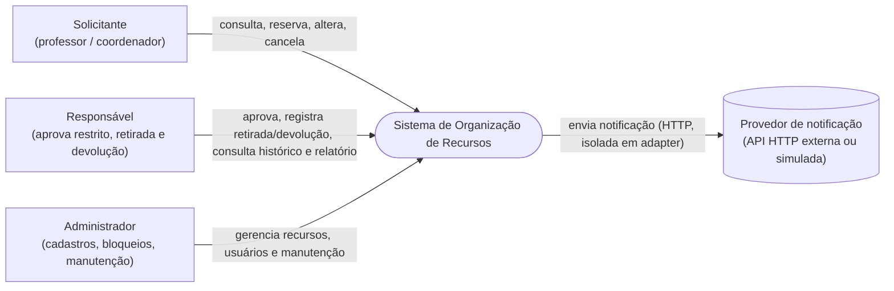
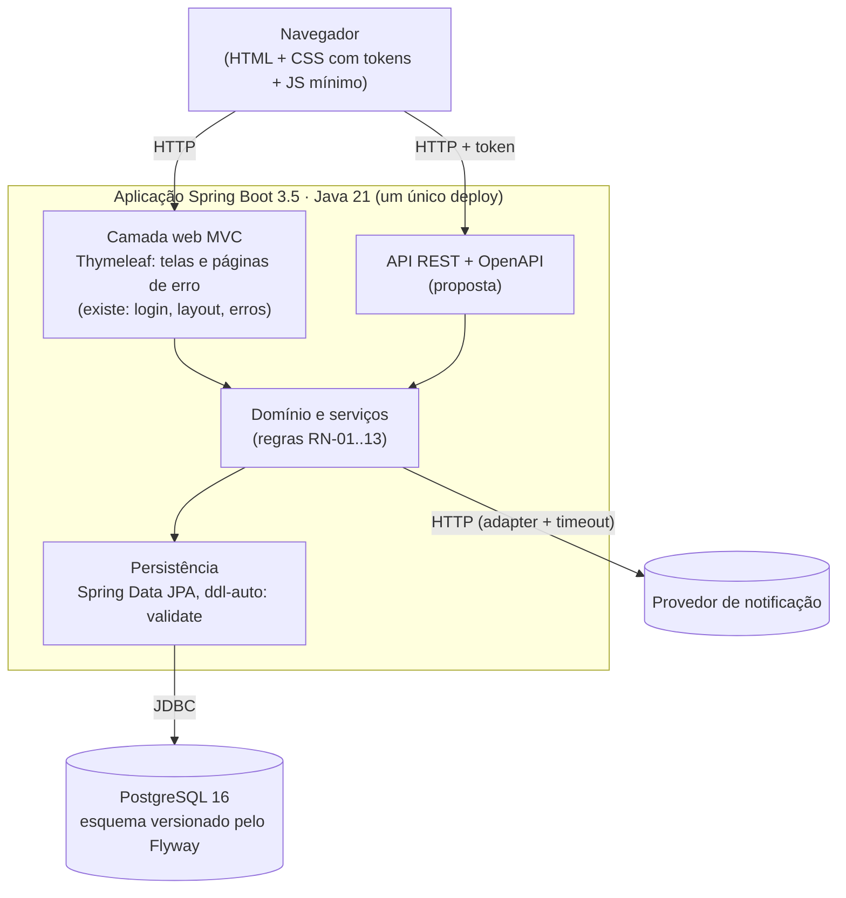
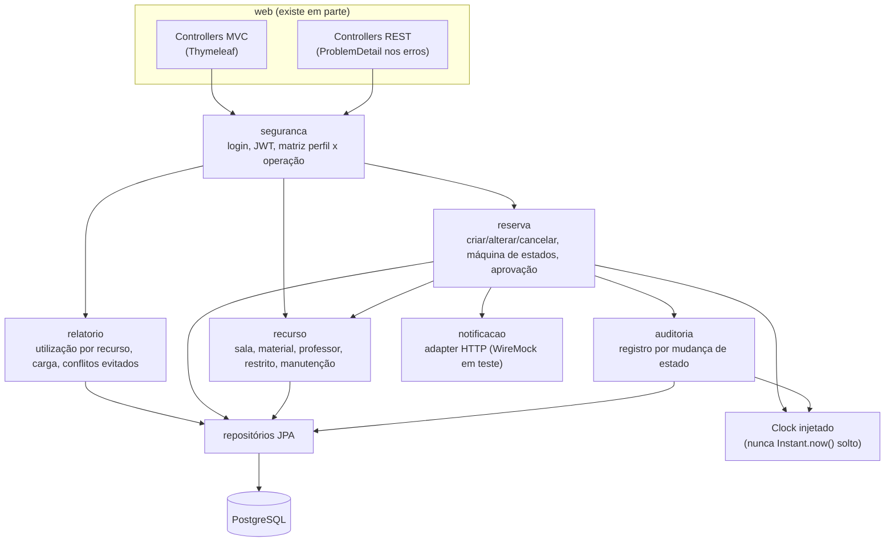

# Arquitetura — Organização de Recursos

> **Esqueleto da Etapa 1 (Aulas 03 e 04).** Estrutura completa e primeiras versões dos diagramas, escritas a partir do [PRD](prd.md), dos [ADRs](adr/) e do [plano](plano-execucao.md). Última atualização: 05/11/2026 (ciclo 01 da avaliação ligado em 07/11/2026).
> **O que é fato e o que é proposta:** o que existe no código hoje está marcado como *existe*. O resto é **proposta** (de Gustavo, dono da arquitetura) para o Pedro (back-end) e o Leandro (front-end) validarem antes da implementação. Números vêm do PRD e continuam "a validar" até serem medidos: o que não foi medido está escrito **"não medido"**.
> Os diagramas usam Mermaid e aparecem renderizados no GitHub.

## 1. Contexto e objetivo
Sistema web para reservar **salas, professores e materiais** sem conflito de horário, para três perfis: **Solicitante** (professor ou coordenador), **Responsável** (aprova recurso restrito, registra retirada e devolução) e **Administrador** (cadastros, bloqueios e manutenção). O foco do projeto é a **evidência de qualidade**, então a arquitetura é desenhada para ser **testável**: relógio injetado, banco real em teste, integração externa isolada.

Requisitos: `docs/prd.md` (RF-01..14, RN-01..13, RNF-01..03). Os quatro limitadores de nota (aplicação que não executa, pipeline ausente, falha de autorização, reserva dupla) orientam as decisões abaixo.

## 2. Diagrama de contexto (C4 nível 1)


## 3. Diagrama de contêineres (C4 nível 2)

- **Um deploy só** ([ADR-0003](adr/0003-thymeleaf.md)): telas Thymeleaf no mesmo projeto Spring, sem front separado.
- **Banco no Docker** em desenvolvimento (`docker-compose.yml`) e **Testcontainers** em teste, nunca H2 (política em [plano-de-teste.md](plano-de-teste.md)).
- **Login com token JWT** ([ADR-0001](adr/0001-login-jwt.md)): o token vai em cada requisição à API.

## 4. Diagrama de componentes (C4 nível 3) — proposta
Hoje existe só o pacote `br.com.senac.recursos.web` (`LoginController`, páginas de erro). Os demais pacotes abaixo são **a combinar com o Pedro** antes de existirem.


## 5. Sequências críticas
### 5.1 Criar reserva (RF-04, RF-05, RF-06, RN-01..04, RN-08)
```mermaid
sequenceDiagram
    actor S as Solicitante
    participant API as API REST
    participant SEG as Segurança (JWT)
    participant SRV as Serviço de reserva
    participant DB as PostgreSQL
    participant AUD as Auditoria
    participant NOT as Notificação (HTTP)

    S->>API: POST /reservas (token, recurso, início, fim)
    API->>SEG: valida token e perfil
    SEG-->>API: 401 se sem token / 403 se perfil não permitido
    API->>SRV: criar reserva
    SRV->>SRV: término depois do início? (RN-01, senão 400)
    SRV->>DB: recurso em manutenção no período? (RN-04, senão recusa)
    SRV->>DB: INSERT reserva (constraint EXCLUDE USING gist em tstzrange)
    alt intervalo livre
        DB-->>SRV: ok
        SRV->>AUD: registra SOLICITADA (mesma transação, RN-08/RN-12)
        SRV-->>API: reserva criada
        API-->>S: 201
        SRV--)NOT: notifica (depois do commit; falha não desfaz a reserva)
    else sobreposição (inclusive pedido simultâneo)
        DB-->>SRV: violação da constraint
        SRV->>SRV: grava tentativa recusada (transação própria)
        SRV-->>API: conflito
        API-->>S: 409 (ProblemDetail, sem stack trace)
    end
```
Pontos a decidir (viram ADR ou pergunta em aberto): (a) a tentativa recusada precisa ser gravada **fora** da transação que sofreu rollback, senão o "conflitos evitados" do relatório (RF-12) perde dado (**decidido em 05/11, D2**: transação própria; [ADR-0002](adr/0002-anti-reserva-dupla.md)); (b) a notificação só dispara depois do commit ([ADR-0005](adr/0005-notificacao-cliente-http-isolado.md)); (c) a agenda do **professor** também entra na constraint (RN-02), não só a do recurso.

### 5.2 Aprovar reserva de recurso restrito (RF-07, RN-05, RN-06, RN-08)
```mermaid
sequenceDiagram
    actor R as Responsável
    participant API as API REST
    participant SEG as Segurança (JWT)
    participant SRV as Serviço de reserva
    participant DB as PostgreSQL
    participant AUD as Auditoria

    R->>API: POST /reservas/{id}/aprovacao (token)
    API->>SEG: valida token
    SEG-->>API: 401 sem token
    API->>SRV: aprovar(id, usuário)
    SRV->>DB: carrega reserva e recurso
    alt usuário não é Responsável, ou é quem pediu a reserva
        SRV-->>API: proibido
        API-->>R: 403 (reserva continua SOLICITADA)
    else reserva SOLICITADA e perfil correto
        SRV->>DB: estado SOLICITADA para APROVADA
        SRV->>AUD: registra mudança (mesma transação)
        API-->>R: 200
    else estado não permite a transição
        SRV-->>API: transição inválida
        API-->>R: 409 (decidido em 05/11, D3, `ProblemDetail` de tipo próprio; a confirmar com o Pedro)
    end
```
A rota `POST /reservas/{id}/aprovacao` é **proposta**; as rotas definitivas saem do inventário de telas (`docs/frontend/telas.md`) e do controller do Pedro.

## 6. Utility tree (proposta)
Prioridade: importância para o negócio (A alta, M média, B baixa) × dificuldade/risco técnico. Foco nos atributos que o professor ataca.

| Atributo de qualidade | Refinamento | Cenário (ver seção 7) | Importância | Risco |
|---|---|---|---|---|
| Integridade dos dados | Nenhuma reserva sobreposta, mesmo com pedidos simultâneos | C1 | A | A |
| Segurança | Cada perfil só faz o que a matriz permite; erro sem stack trace | C2 | A | M |
| Desempenho | Busca de disponibilidade e criação de reserva sob 50 usuários | C3 | M | M |
| Auditabilidade | Toda mudança de estado gera registro, na mesma transação | C4 | A | M |
| Testabilidade | Tempo controlado (`Clock`), banco real, integração externa isolada | transversal | A | B |
| Usabilidade | Telas responsivas (375 px) e mensagens de erro claras | C5 | M | B |
| Manutenibilidade | Esquema só por Flyway; regras de negócio fora dos controllers | transversal | M | B |

## 7. Cenários de qualidade em 6 partes (rascunho; números do PRD, a validar)
| | C1 · Reserva dupla | C2 · Autorização | C3 · Desempenho |
|---|---|---|---|
| Fonte do estímulo | 20 clientes (teste automatizado) | Solicitante autenticado | 50 usuários simulados no JMeter |
| Estímulo | 20 pedidos simultâneos para o mesmo recurso e horário | Pede a alteração da reserva de outro Solicitante | Consulta de disponibilidade e criação de reserva |
| Artefato | Banco (constraint) e serviço de reserva | Segurança e serviço de reserva | API REST |
| Ambiente | Operação normal, PostgreSQL real em container | Operação normal | Máquina local, aplicação local (não medir produção) |
| Resposta | Uma reserva aceita, as outras recusadas | Acesso negado, reserva intacta | Respostas dentro do limite |
| Medida | 1 aceita e 19 × 409; **uma linha no banco** para o intervalo | 403 em 100% das tentativas da matriz | p95 ≤ 300 ms e erro < 1% (RNF-01 e RNF-03; só 201 ou 409 na criação) |
| Estado | meta definida; **não medido** | meta definida; **não medido** | meta definida; **não medido** |

Outros cenários (esboço): **C4** mudança de estado sem auditoria → impossível (rollback não deixa auditoria órfã); **C5** tela de reserva em 375 px sem rolagem horizontal e erro de conflito explicado em linguagem simples.

## 8. Pontos de sensibilidade e trade-offs
| Decisão | Ponto de sensibilidade | Trade-off | Registro |
|---|---|---|---|
| Proteção da reserva no banco (`EXCLUDE USING gist` sobre `tstzrange`, extensão `btree_gist`) em vez de lock pessimista | A **definição do intervalo** (semiaberto `[início, fim)`) muda o resultado das fronteiras; a constraint precisa cobrir recurso **e** professor | + Funciona com várias instâncias e é a prova mais forte para a banca; − depende de recurso específico do PostgreSQL e exige tratar a violação da constraint como 409 | [ADR-0002](adr/0002-anti-reserva-dupla.md) |
| JWT temporário em cada requisição | Tempo de vida do token e perfil dentro dele | + Casa com os roteiros de JMeter e de teste por perfil; − revogação imediata não existe | [ADR-0001](adr/0001-login-jwt.md) |
| Thymeleaf no mesmo projeto | Responsividade e testes E2E dependem de HTML do servidor | + Um deploy, menos peças; − sem SPA, interações ricas são limitadas | [ADR-0003](adr/0003-thymeleaf.md) |
| Notificação via cliente HTTP isolado | Timeout e falha do provedor | + Falha externa não derruba a reserva e é testável com WireMock; − notificação pode se perder (aceito: é "simulada") | [ADR-0005](adr/0005-notificacao-cliente-http-isolado.md) (proposto) |
| Migrações Flyway como dono do esquema | Ordem e imutabilidade das versões | + Esquema reproduzível no CI e em clone limpo; − migração mergeada não se edita, corrige-se com a próxima | [ADR-0006](adr/0006-flyway-dono-do-esquema.md) (proposto) |

## 9. Riscos
| # | Risco | Efeito | Mitigação | Evidência prevista |
|---|---|---|---|---|
| R1 | Dupla reserva sob concorrência | **Zera a nota** (limitador) | Constraint no banco + teste de 20 pedidos que fica vermelho sem a proteção | Teste de concorrência; `docs/testes/mutacao-manual.md` |
| R2 | Falha de autorização | **Zera a nota** | Matriz perfil × operação testada célula a célula; 401 e 403 explícitos | `docs/seguranca/matriz-autorizacao.md` e teste parametrizado |
| R3 | Tentativa recusada perdida no rollback | "Conflitos evitados" do relatório fica errado | Gravar em transação própria; teste que prova a contagem | Teste do relatório com valores calculados à mão |
| R4 | Fronteira do intervalo (decidida em 05/11, D1: `[início, fim)`) não refletida no BDD e nos testes | Teste e banco discordam | Atualizar a tabela de fronteiras do BDD (Pedro) antes do primeiro teste vermelho | `docs/testes/bdd-aprovacao-bloqueio.md` |
| R5 | Prazo curto (entrega 13/11) | Escopo não fecha | Limitadores primeiro; UI mínima; PRs pequenos por etapa | Plano de execução |
| R6 | Docker indisponível em alguma máquina | Teste de integração não roda local | Docker como pré-requisito; CI já tem Docker | `Skipped: 0` no `verify` |
| R7 | Token do provedor de notificação vazar na resposta ou no log | Falha de segurança | Segredo só em variável de ambiente; teste do WireMock "token não vaza" | Teste do adapter |
| R8 | Histórico "fabricado" (red depois do green) | Perde pontos de autoria | Commits `test(red)` antes de `feat(green)`; merge com merge commit | `docs/testes/evidencia-tdd.md` |

## 10. Matriz requisito → decisão → componente → evidência (inicial)
A coluna "Evidência" é preenchida conforme os testes existem (a RTM, `docs/rtm.md`, é o documento oficial de rastreabilidade).

| Requisito | Decisão | Componente | Evidência |
|---|---|---|---|
| RF-01 login e permissão | ADR-0001 | seguranca | a preencher |
| RF-04, RF-05 reservas e sobreposição | ADR-0002, ADR-0007 | reserva, banco | parcial (06/11): sobreposição de recurso e de professor recusada pelo banco em `SobreposicaoBancoTest`; API e regra de serviço ainda sem teste |
| RF-06 reserva dupla | ADR-0002, ADR-0007 | banco (constraint) | parcial (06/11): `ConcorrenciaReservaBancoTest` (20 threads → 1 aceita e 19 recusadas, contagem no banco, recurso e professor, 5 rodadas); o 409 de ponta a ponta depende do serviço do Pedro |
| RF-07 aprovação de restrito | máquina de estados | reserva, seguranca | a preencher |
| RF-08 manutenção | intervalo semiaberto (D1, decidido em 05/11) | recurso, reserva | a preencher |
| RF-10 histórico auditável | auditoria na mesma transação | auditoria | a preencher |
| RF-11 notificação | adapter HTTP isolado (ADR-0005) | notificacao | a preencher |
| RF-12 relatório | tentativa recusada gravada | relatorio, banco | parcial (06/11): tabela `tentativa_recusada` e gravação em transação própria em `TentativaRecusadaBancoTest`; a consulta do relatório ainda não existe |
| RF-13 telas e erros claros | ADR-0003 | web | a preencher |

## 11. Pendências deste documento
- [ ] Validar pacotes e rotas com o Pedro e as telas com o Leandro.
- [x] Completar a seção "Consequências" dos ADRs 0001 a 0004 e escrever os ADRs de notificação e de Flyway (Etapa 2). — feito em 05/11: ADRs 0001 a 0004 com ganhos, perdas e testes exigidos; ADR-0005 (notificação) e ADR-0006 (Flyway) escritos com status **proposto**, a validar com o Pedro.
- [x] Decidir o intervalo semiaberto (pergunta em aberto do BDD) e registrar no ADR-0002. — D1 decidida em 05/11 pelo Gustavo (`[início, fim)`), registrada no ADR-0002 e na seção 9 do [plano](plano-execucao.md); a confirmar com Pedro e Leandro na revisão.
- [x] D2 (tentativa recusada em transação própria), D3 (409 para transição inválida) e D5 (estados que ocupam o horário), seção 9 do plano: decididas em 05/11 e registradas nos ADRs 0002, 0005 e 0006.
- [x] Migração V1 e modelagem da proteção contra reserva dupla (professor como recurso, estado copiado por FK composta, trava por recurso). — feito em 06/11 no PR `feat/banco-v1`: D6 e D7 (seção 9 do plano) e [ADR-0007](adr/0007-modelagem-protecao-reserva-dupla.md), proposto; a confirmar com o Pedro.
- [ ] Atualizar a tabela de fronteiras e a pergunta em aberto de `docs/testes/bdd-aprovacao-bloqueio.md` com a D1 (arquivo do Pedro; não alterado neste PR).
- [ ] D4 (critério de "0 vulnerabilidades críticas"): resposta do professor ainda pendente.
- [x] Ciclo 01 da avaliação arquitetural: [`docs/avaliacao-arquitetural/ciclo-01.md`](avaliacao-arquitetural/ciclo-01.md) (Etapa 3). — feito em 07/11: cenários C1 a C5, sensibilidades, trade-offs e riscos ligados aos ADRs; rascunho do Gustavo, a validar com Pedro e Leandro.
